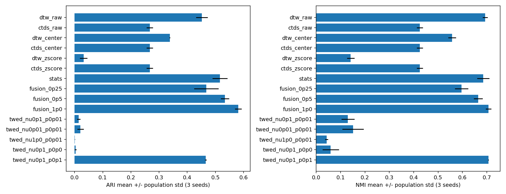
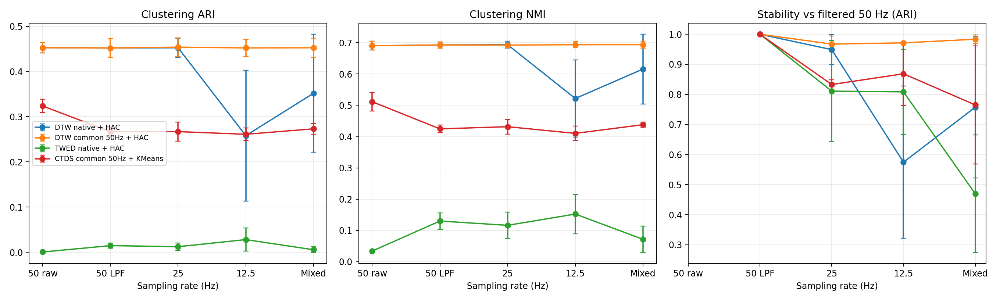

# HAR Sampling Rate Clustering Pilot

UCI HAR 时间序列采样频率聚类初步实验。比较原频率 DTW、统一采样后的 DTW、带时间戳 TWED，以及统一采样后的 CTDS 适配版本。

## 新增：第一轮诊断与第二轮实验

第二轮已完成165次聚类，沿用第一轮的三个种子和样本。所有结果为开发集诊断，尚未完成独立受试者验证。

- [第二轮结论与证据位置](results/round2/CONCLUSIONS.md)
- [第二轮完整结果](results/round2/REPORT.md)、[汇总指标](results/round2/summary.csv)、[逐样本预测](results/round2/assignments.csv)
- [第二轮实验设置](ROUND2_EXPERIMENT.md)、[运行代码](run_round2.py)、[独立校验代码](validate_round2.py)
- [第二轮独立校验记录](results/round2/independent_validation.json)：165组指标及计数表、60个距离矩阵、33项基线复现通过检查。
- [第一轮诊断说明](ROUND1_DIAGNOSTICS.md)、[诊断报告](diagnostics/round1/DIAGNOSTIC_REPORT.md)、[诊断代码](diagnose_round1.py)

低通50Hz条件下，原CTDS平均ARI为0.2668；仅统计特征为0.5162；CTDS与统计特征融合、统计块权重1时为0.5815。TWED固定nu=0.1，将删除惩罚从0.01改为0.1，平均ARI从0.0146提高到0.4658。融合后坐着与站着仍明显混淆，详细限制见结论文件。



每个 `results/round2/seed_*/条件/方法/` 目录含类别×簇计数、行百分比、热力图及簇大小图。簇编号没有活动类别含义。

复现示例（先安装原有requirements.txt依赖，自行下载UCI HAR）：

```powershell
python run_round2.py --data-dir "D:/cluster/data" --output results/new_round2
python validate_round2.py --output results/new_round2
```

数据路径可按实际位置修改。已发布的 `results/round2` 非空，请使用新输出目录。原始数据、重采样数组、距离矩阵和虚拟环境不上传；完整校验脚本需对重新运行生成的完整输出执行。HTML总览请下载后在浏览器打开。公开JSON中的本机路径已替换为占位符，原始输入和运行代码哈希保留。

本项目包含已运行的 **4组方法 × 5种采样条件 × 3个种子 = 60组评估**。每次从六类活动各抽50条，共300条，使用 `total_acc_x` 单通道。真实标签仅用于平衡抽样和评价，不参与表示/距离构造，不按标签搜索参数。

## 查看结果

- [实验报告](EXPERIMENT_REPORT.md)
- [独立HTML报告](EXPERIMENT_REPORT.html)：下载后用浏览器打开，图表已内嵌。
- [详细实验设置和限制](EXPERIMENT_DETAILS.md)
- [三次运行汇总](results/pilot_300/summary.csv)
- [逐次指标](results/pilot_300/metrics.csv)
- [全部预测](results/pilot_300/assignments.csv)



混合频率条件下的均值：

| 方法 | ARI | NMI |
|---|---:|---:|
| 原频率DTW＋平均连接层次聚类 | 0.3518 | 0.6159 |
| 统一50Hz后DTW＋平均连接层次聚类 | 0.4526 | 0.6939 |
| TWED＋平均连接层次聚类 | 0.0055 | 0.0717 |
| 统一50Hz后CTDS＋KMeans | 0.2731 | 0.4380 |

这是单通道、固定参数和三个抽样集上的探索性结果，不是通用算法排名。TWED当前设置出现明显簇大小失衡；本轮未证明自然变长或复杂非平稳过程的处理能力。HAR窗口有50%重叠，本轮不是受试者隔离的泛化实验。CTDS逐窗口标准化与距离方法保留原值的差异，也可能影响结果。

## 环境与数据

需要 Python 3.12。原始数据和虚拟环境不包含在仓库内。

1. 从 [UCI HAR官方下载页](https://archive.ics.uci.edu/dataset/240/human+activity+recognition+using+smartphones) 下载ZIP并解压。
2. 将解压文件夹置于 `data/`，或用 `--data-dir` 指定其父目录。程序会递归定位同时包含 `activity_labels.txt`、`train/y_train.txt` 的根目录；重复解压多份时请指定更精确的路径。
3. 使用 `Inertial Signals` 下的窗口信号，不使用561维人工特征表。

Windows PowerShell：

```powershell
python -m venv .venv
& ./.venv/Scripts/python.exe -m pip install -r requirements.txt
& ./.venv/Scripts/python.exe check_algorithms.py
& ./.venv/Scripts/python.exe run_experiment.py --data-dir ./data --output results/my_run
& ./.venv/Scripts/python.exe validate_results.py results/my_run
& ./.venv/Scripts/python.exe make_report.py --results results/my_run
```

Linux/macOS：

```bash
python3.12 -m venv .venv
.venv/bin/python -m pip install -r requirements.txt
.venv/bin/python check_algorithms.py
.venv/bin/python run_experiment.py --data-dir ./data --output results/my_run
.venv/bin/python validate_results.py results/my_run
.venv/bin/python make_report.py --results results/my_run
```

快速流程测试（非主要实验）：

```bash
python run_experiment.py --data-dir ./data --per-class 6 --seeds 2026 --psi 16 --repetitions 5 --output results/my_smoke
```

输出目录非空时程序拒绝覆盖。仓库已经包含 `results/pilot_300`，请为新实验指定新目录。`make_report.py` 会更新根目录报告和图表，需要保留时先自行另存。

## 方法及采样条件

采样条件为50Hz原始、50Hz仅低通、25Hz、12.5Hz，以及每个样本随机分配一种频率的混合条件。低频和混合条件均先使用6阶Butterworth 5Hz低通，再以多相滤波重采样；名义窗口时长保持2.56秒。只做低通的50Hz版本用于分离滤波与采样密度影响。

DTW不直接使用时间戳；TWED使用秒级时间戳、p=1、nu=0.1、lambda=0.01；两者使用平均连接层次聚类，K=6。CTDS采用两区64点、每区32点窗口、psi=128、50次随机分区、KMeans n_init=10。这是按物理尺度指定区域的适配实验，不是原论文对HAR的最优设置复现。

## 可复现范围

公开结果包括指标、预测、原样本行号、参数、文件哈希及验证记录。为避免重新分发数据，原始/重采样数组和距离矩阵不上传；运行后会自动生成这些文件。`validate_results.py` 的完整验证需要重新运行生成的NPZ与距离矩阵；不能直接对仅含摘要的已发布结果目录执行完整验证。

原始执行代码的哈希保留于config.json；分享版本修改了数据目录默认值、文档和报告脚本，当前文件哈希见 `SHARE_MANIFEST.json`。本地绝对路径已从公开配置中移除。完整运行依赖版本见 `environment_freeze.txt`。

## 原始论文与声明

- DTW: Sakoe & Chiba, 1978. https://doi.org/10.1109/TASSP.1978.1163055
- TWED: Marteau, TPAMI 2009. https://doi.org/10.1109/TPAMI.2008.76
- CTDS: Gong et al., PAKDD 2024. https://doi.org/10.1007/978-981-97-2242-6_21
- CTDS作者代码：https://github.com/LeisureGong/CTDS
- UCI HAR: Anguita et al., A Public Domain Dataset for Human Activity Recognition using Smartphones, ESANN 2013.

这是实验性实现与方法组合，不是上述作者的官方发布仓库；使用数据和方法时请引用原始来源。仓库未附加原作者代码的再许可声明。
